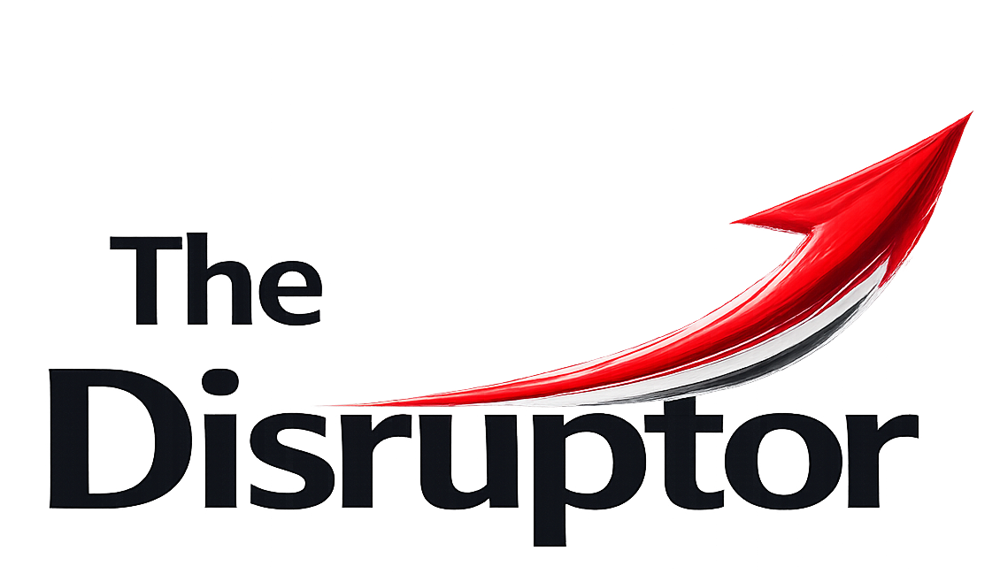

<p align="center"></p>

# The Disruptor: A Corporate Entrepreneurship & Innovation Simulation

A free browser simulation for teaching corporate entrepreneurship and innovation management.

Version 2.0.0 · November 2026

**Play online:** https://disruptorsim.org/play/ · **Website:** https://disruptorsim.org · **Mirror:** https://ammonsalter-del.github.io/thedisruptor-sim/

## What the game is

The player becomes Chief Innovation Officer of Vélox Dynamics, a fictional fitness equipment manufacturer in Vilvoorde, Belgium, with a forty-year heritage. The brief runs for three years, or for a one-year probation that can lead on to the full term.

Each year the management board meets on the firm's direction and the CEO decides it. The CIO is given a goal and three objectives for the year. At the end of the first and second years the board questions the CIO on the year. Markets move and competitors act. Grants succeed or fail. Staff arrive and leave. Projects land and miss.

The role is played by balancing many things at once, under pressure, with incomplete information. Time moves in weeks and quarters, and decisions compound. Good years can mask bad calls. Bad luck can bury good ones.

A typical week brings a scouted opportunity, a proposal from the R&D Director, a competitor launch, a grant decision, a staff request or an event. The player reads, decides, delegates or defers. Over a quarter these add up to a portfolio story, and over a year to a performance review. The tenure ends with a report on what happened and why.

## How it works

The game is organised around sixteen modals, each covering one system the CIO has to manage: R&D Portfolio, Innovation Launchpad, Innovation Strategy, Alliances, Standards, Platform, IP Management, Tech Scouting, Universities & Research, Corporate Venturing, Crowdsourcing, Staff & Hiring, Organisation, Competitors & Markets, Grant Funding and Corporate.

The modals share a dashboard. A central network map shows capabilities and products and how they connect. A Message Centre collects what needs the CIO's attention and paces it so the player can think.

The systems are connected. An alliance feeds capability. Capability shapes R&D, R&D produces innovations, and innovations meet the market through the Launchpad. Market performance funds the next round of decisions.

Behind the modals sits the Pantheon of Innovation, an in-game library of scholars whose ideas bear on the player's situation, from Schumpeter and Penrose to Freeman, Nelson and Teece.

The game teaches itself as you play. Tutorials and guides run through it, and the early weeks bring the player in. There is no manual to read first.

## How to play

Download this folder and open `index.html` in a modern browser, from the folder it sits in. It needs no install, no server and no account. The other files must stay beside `index.html`: the game loads its scene pages, mini-games and pictures from the same folder.

You can also play online at https://disruptorsim.org/play/. The game's own repository mirrors the same files, served at https://ammonsalter-del.github.io/thedisruptor-sim/.

## What is in the `play` folder

- `index.html`: the game itself, in one file.
- `scene-strategy.html`, `scene-desk.html`, `scene-appraisal.html`, `scene-end.html`: the four scene pages. They hold the board's meeting at the start of each year, the CIO's desk with the year's pack, the end-of-year appraisal and the last day of the tenure.
- `defender.html`, `pinball.html`, `wellness_orbit_run.html`: the three mini-games (Lead User Patrol, Design Thinking Pinball, Wellness Orbit Run).
- `jspdf.umd.min.js`: the library that makes the end-of-game report as a PDF, so the report works without an internet connection.
- `end-pictures.js`: copies of the pictures the report and the postcard use, so they are drawn when the game is played from a folder.
- `disruptor-shim.js`: the add-on for competitive play. With it, a Forge game sends its yearly results, anonymously, so players and classes can compare. Remove the file and nothing is sent.
- Pictures (`.webp`, `.jpg`, `.png`): the people, products, places and rival firms of the game, its logo and the figures used in the end-of-game report.
- `LICENSING.md` and the two licence texts.

## The versions of the game

Forge is the core game: three years as CIO, or a one-year probation that can lead on to the full term.

Incubator is Forge for first-time players. Fewer systems are open at the start, and the rest open when the player is ready.

Three harder versions are still marked experimental. Pivot takes Vélox into one of four new sectors. Jugaad works on far less money and with no inherited projects. In Gauntlet the markets are hostile and competitors strike early.

## What is new in Version 2

The first change is AI. On the AI & Innovation tab of the Organisation window the CIO decides how far AI goes in R&D, from copilots to AI agents. The CIO pays for it from the innovation budget and chooses a provider, how people learn the tools and who may use the firm's data. These choices reach staff, intellectual property and the firm's purpose, and AI brings news of its own.

The second is the board in person. Each year opens with the management board meeting on the firm's direction, where the CEO decides. A pack on the CIO's desk then sets out the year's goal and objectives. At the end of the first and second years the CIO answers the board's questions at the end-of-year appraisal and is given a score.

The third is the ending. The tenure closes with a report, *Your tenure at Vélox*. It sets the board's view of the results beside the game's own assessment of how the player used the tools of corporate entrepreneurship and innovation management.

Version 2 also brings:

- longer guides for each system, written to make the player aware of what matters without telling them how to play;
- a redrawn look for several system windows, among them Competitors & Markets, Alliances, Standards, Staff & Hiring and Universities & Research;
- money that behaves more like a firm's: an overspent innovation budget is carried and taken from next year's allocation, AI costs are closer to what firms pay today, and a project the player chooses to stop returns only part of its unspent budget;
- a board that watches layoffs: ten in one year ends the appointment;
- an end-of-game report that can be made with no internet connection, with the game's own pictures and icons;
- a grant won for a proposal asks the player first: start the project now, or hold the grant;
- competitive play for the Forge: results compared with other players', and a page for lecturers to follow their class (https://disruptorsim.org/classroom.html);
- a plain statement of what the licences permit and do not permit, the use of the game to train commercial AI models included.

## Teaching materials

The Vélox case study, teaching notes, slides, exam questions and discussion prompts are written for classroom use. They are not in this folder. They are available from the author for use in university teaching, and more is on the website at https://disruptorsim.org/educators.html.

## Earlier versions

- Version 1.0, April 2026.
- Version 1.0.2, September 2026: https://doi.org/10.5281/zenodo.21127039

## How to cite

Salter, A. (2026). *The Disruptor: A Corporate Entrepreneurship & Innovation Simulation* (Version 2.0.0) [Software]. Warwick Business School, University of Warwick. https://disruptorsim.org

```bibtex
@software{salter2026disruptor,
  author      = {Salter, Ammon},
  title       = {The Disruptor: A Corporate Entrepreneurship \& Innovation Simulation},
  year        = {2026},
  version     = {2.0.0},
  url         = {https://disruptorsim.org},
  institution = {Warwick Business School, University of Warwick}
}
```

`CITATION.cff` in this repository holds the same information for GitHub's "Cite this repository" button.

## Licences

The Disruptor has two licences.

The educational content is licensed under Creative Commons Attribution-NonCommercial-ShareAlike 4.0 International (CC BY-NC-SA 4.0). This covers the text, scenarios, characters, pictures and documents, and the teaching materials. Full text: `LICENSE-CONTENT-CC-BY-NC-SA-4.0.txt`.

The software is licensed under the PolyForm Noncommercial License 1.0.0. This covers the source code. Full text: `LICENSE-SOFTWARE-PolyForm-Noncommercial-1.0.0.txt`.

Required Notice: Copyright 2026 Ammon Salter (https://disruptorsim.org)

`LICENSING.md` says which licence covers what. Commercial use, including paid consulting, corporate training and client workshops, needs the author's permission.

The PDF library `jspdf.umd.min.js` is a separate work under its own MIT licence, stated at the head of that file.

## Credits

**Created by:** Ammon Salter, Warwick Business School, University of Warwick.

**Development tools:** Built with AI coding assistance from Claude (Anthropic), Gemini (Google) and Codex (OpenAI).

**Contributors:**

- Susanne Beck, Warwick Business School
- Federico Bignone, Warwick Business School
- Paola Criscuolo, Imperial College London
- Linus Dahlander, ESMT Berlin
- Hans Frankort, Bayes Business School, City University of London
- Lars Frederiksen, Aarhus University
- Christos Kolympiris, Warwick Business School
- Keld Laursen, Copenhagen Business School
- Orietta Marsili, University of Bristol
- Dmitry Sharapov, Imperial College London

**Beta testers:** Students of the Corporate Entrepreneurship course, Masters in Management programme, Warwick Business School 2025–26.

**Audio credits:** Sound samples from Freesound.org: "Atmos" by fluxdelux (CC BY 4.0), "Ambient, Pad Piano – Event Horizon" by Andrewkn (CC BY 4.0), "Clank Car Crash Collision" by qubodup (CC0), "crash.wav" by moxobna (CC0), "Rocket 02.wav" by LilMati (CC0).

## Disclaimer

The Disruptor is a work of fiction made for teaching. Its characters, companies, organisations, products, events and scenarios are invented. Any likeness to real people, firms or events is coincidence. The game is not business advice. The scholars of the Pantheon of Innovation are the exception: they are real academics.
